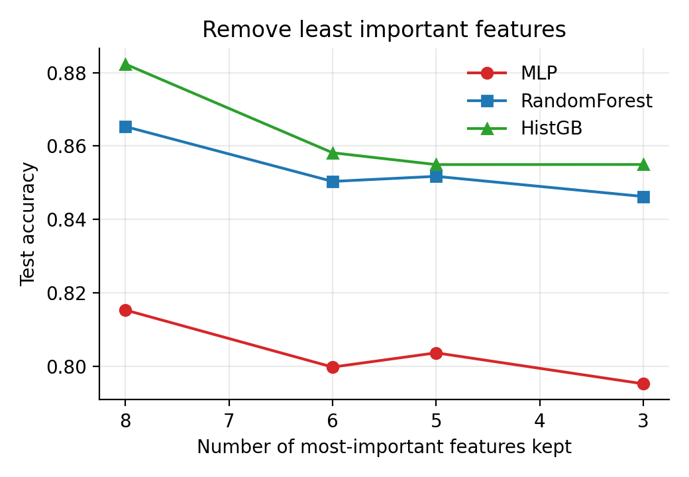
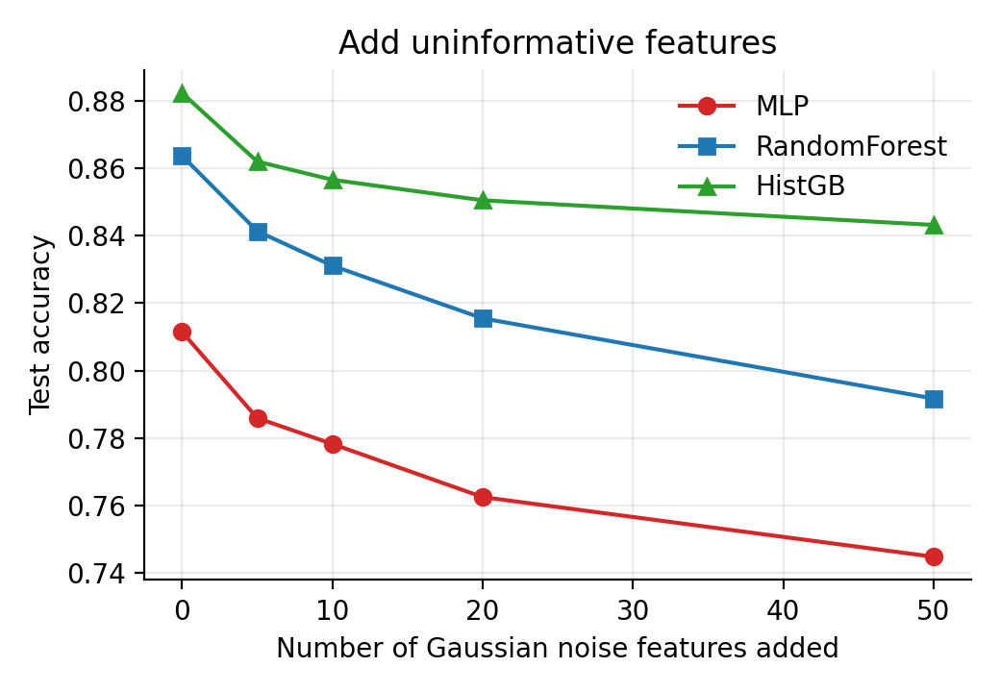
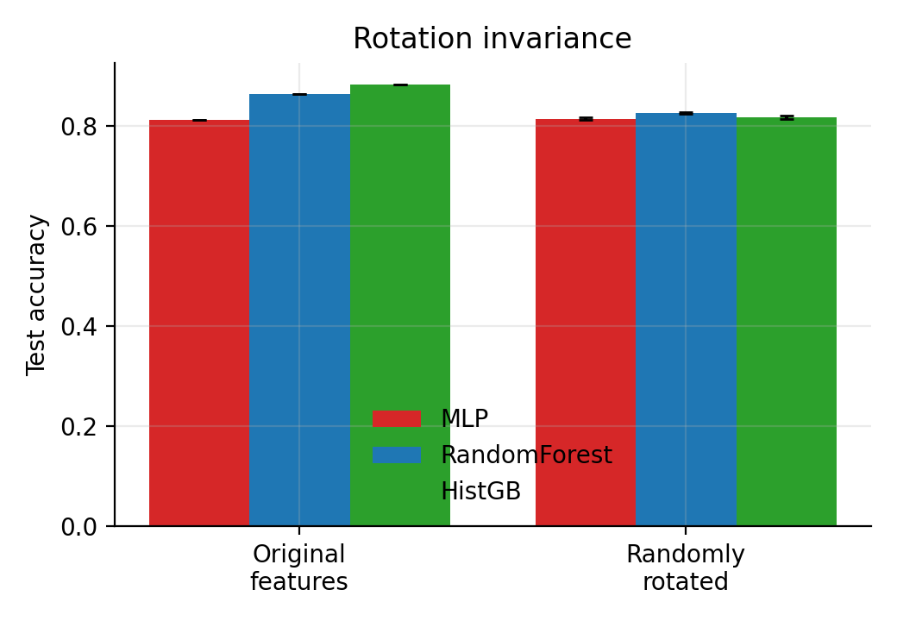

# Tabular Learning Reproduction

Small, from-scratch reproduction of two experiments from:

> L. Grinsztajn, E. Oyallon, and G. Varoquaux. **Why do tree-based models still
> outperform deep learning on tabular data?** *Advances in Neural Information
> Processing Systems (NeurIPS), Datasets and Benchmarks Track*, 2022.

Official paper repository: <https://github.com/LeoGrin/tabular-benchmark>

## Scope

This is a **partial reproduction**, not the full 45-dataset benchmark. It runs on
the OpenML `electricity` classification dataset with a 10,000-sample training
set (the paper's medium-size setting) and reproduces:

1. **Finding 2 — robustness to uninformative features**
   - removing the least important features (ranked by a Random Forest);
   - adding uncorrelated standard Gaussian noise features.
2. **Finding 3 — sensitivity to random orthogonal rotations**
   - Gaussianized features are rotated with random orthogonal matrices and the
     accuracy of an MLP is compared with the two tree models,
     **RandomForest** and **HistGradientBoosting (HistGB)**.

The neural model is a multilayer perceptron (**MLP**), and the two tree models
used throughout are **RandomForest** and **HistGradientBoosting (HistGB)**.

## Setup

Requires Python 3.10+ and internet access to download the OpenML dataset on the
first run.

```bash
python -m venv .venv
source .venv/bin/activate          # Windows: .venv\Scripts\activate
pip install -r requirements.txt
```

## Run

```bash
python reproduce.py                 # writes CSVs to results/
python make_figures.py              # writes PNGs to figures/
```

## Figures







## Reproduced results

On `electricity` (10,000 training samples, fixed seed):

| Condition                 | MLP   | RandomForest | HistGB |
| ------------------------- | ----- | ------------ | ------ |
| All 8 features            | 0.815 | 0.865        | 0.882  |
| Keep 3 most important     | 0.795 | 0.846        | 0.855  |
| Add 20 noise features     | 0.763 | 0.816        | 0.851  |
| Add 50 noise features     | 0.745 | 0.792        | 0.843  |
| Original (rotation study) | 0.811 | 0.864        | 0.882  |
| Rotated (mean over seeds) | 0.814 | 0.826        | 0.818  |

These numbers are generated on a CPU with simple, fixed hyperparameters and
early stopping; the original paper uses a large random search on GPUs, so
absolute accuracy is lower, but the relative ranking and the qualitative effects
match the paper.

## Own contributions vs. reused code

- All code in this directory was written for this reproduction. It uses
  standard libraries only: scikit-learn, NumPy, pandas, SciPy, and Matplotlib.
- No code was copied from the official `tabular-benchmark` repository. The
  experiment design and terminology follow the paper.
- The `electricity` dataset is from OpenML (data id 151), originally the UCI
  "Electricity" dataset.

## Acknowledgements

The experiments are adapted from Grinsztajn et al. (2022), NeurIPS Datasets and
Benchmarks Track. All credit for the original experimental design and findings
goes to the paper's authors.
